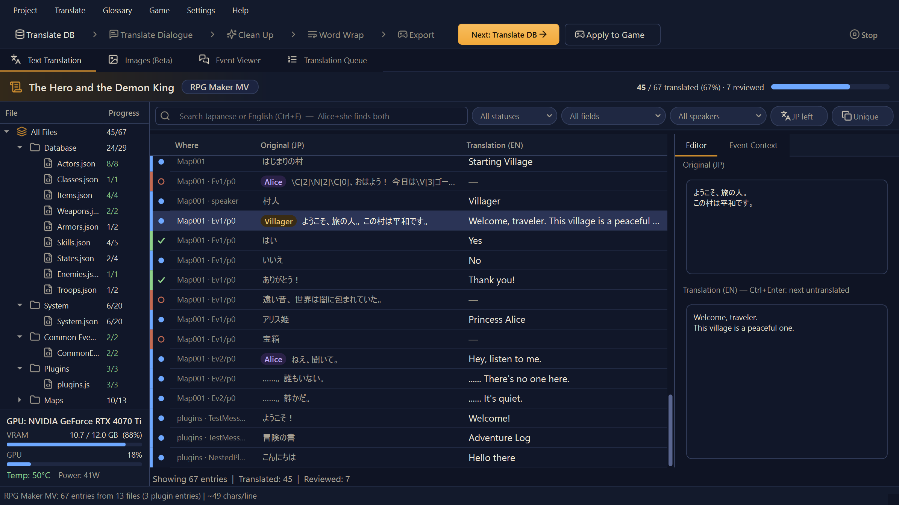
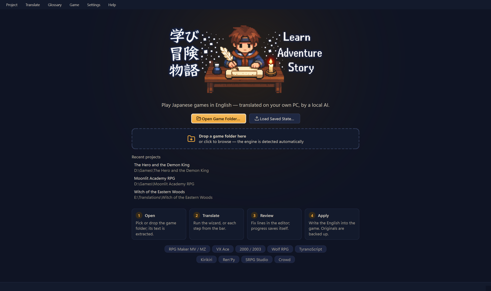
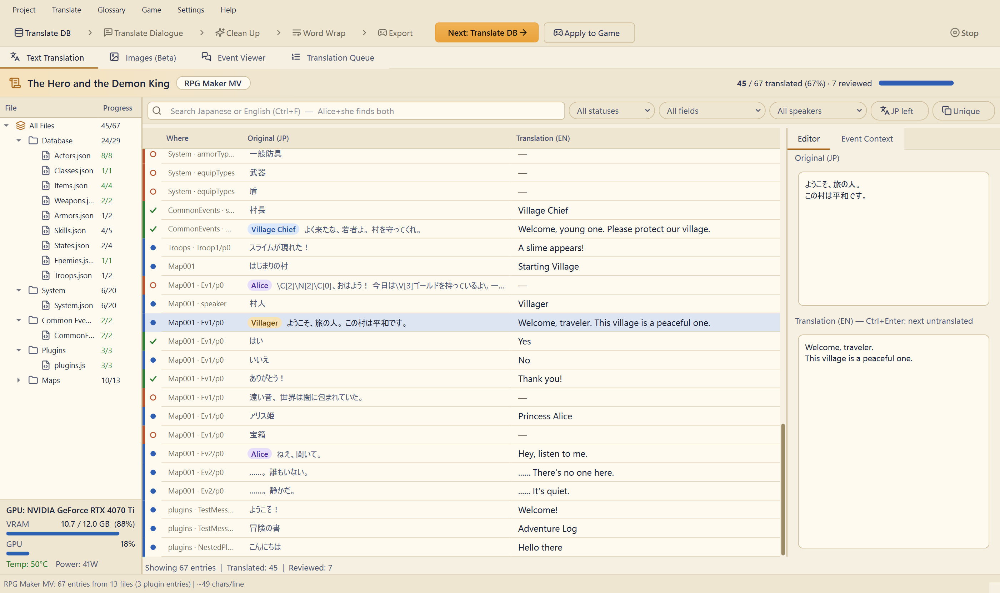
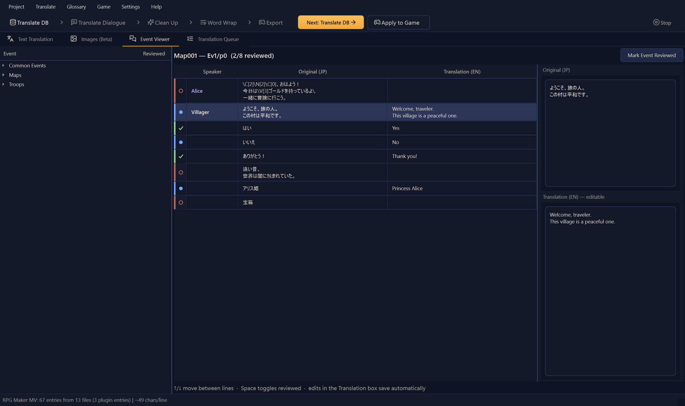
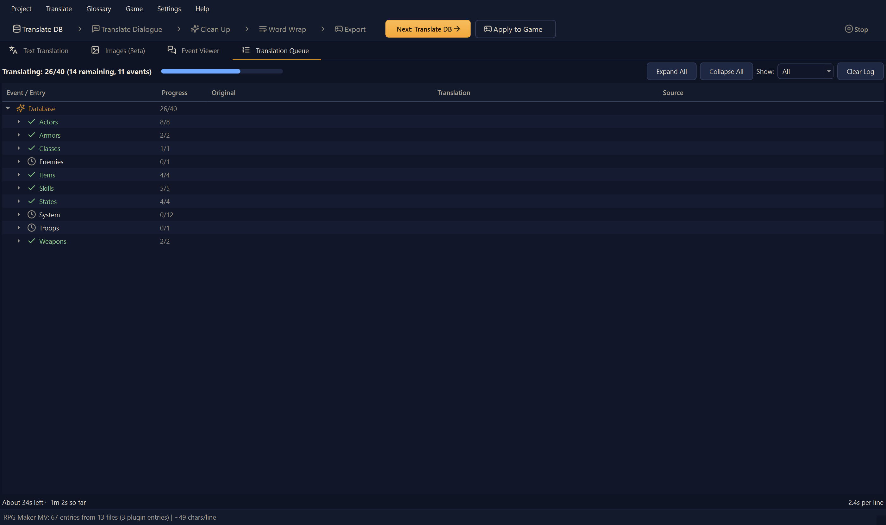
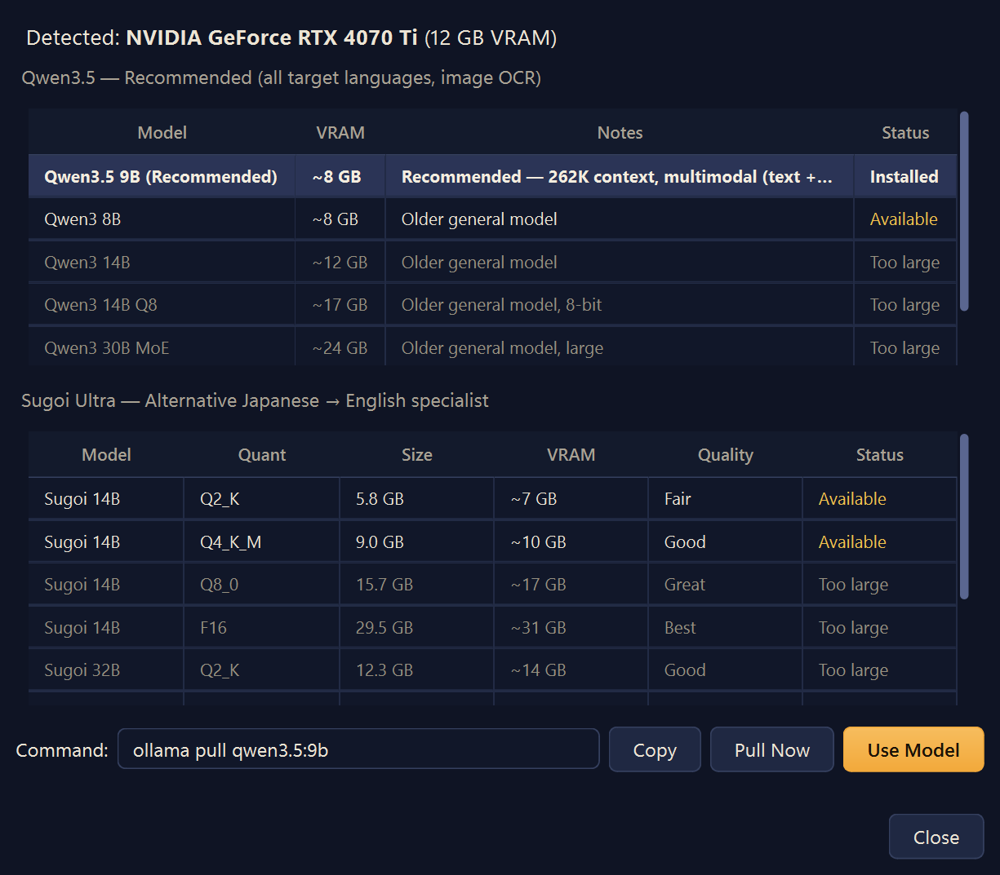
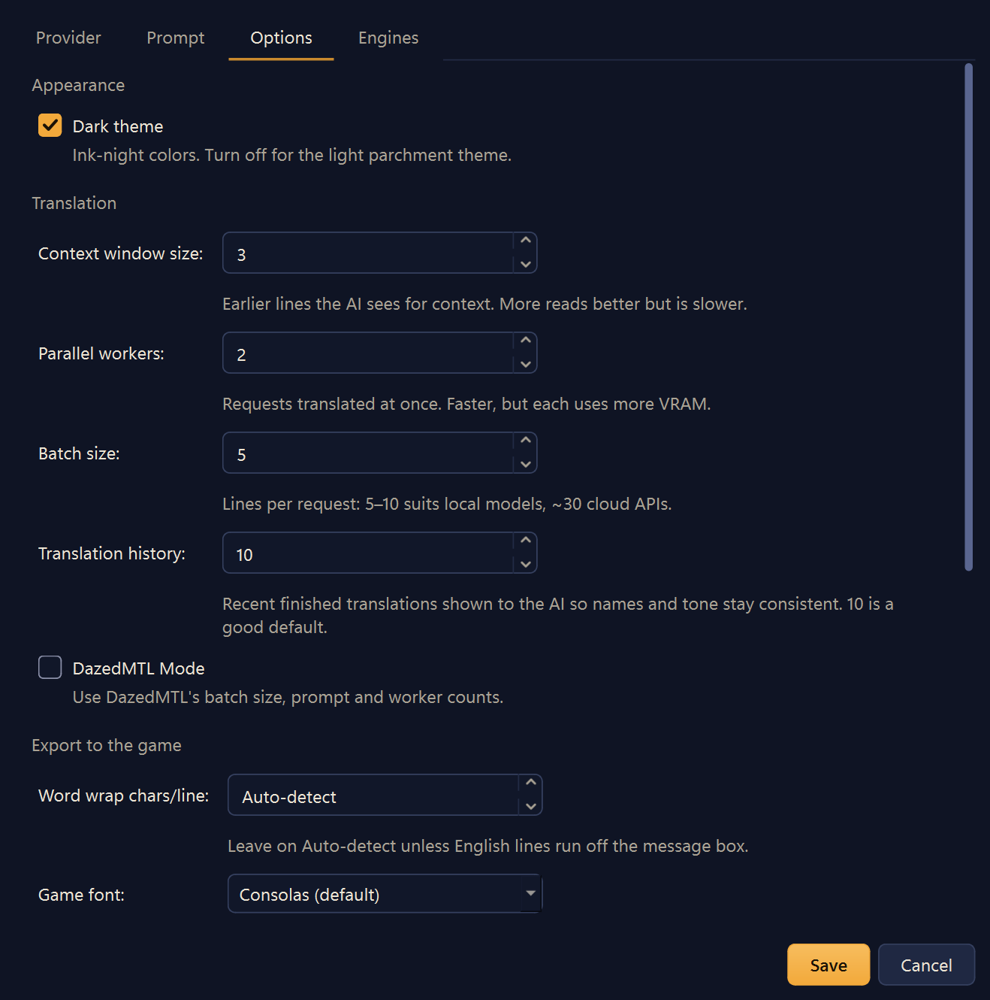
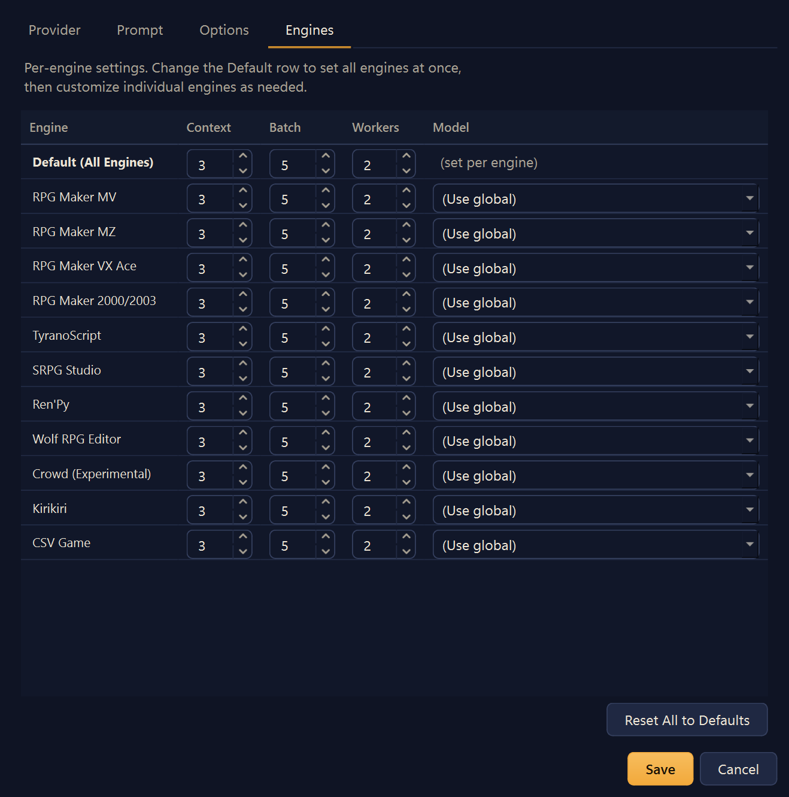

<p align="center">
  
</p>

<h1 align="center">RPG Maker Translator</h1>

<p align="center">
Translate RPG Maker MV/MZ/VX Ace/2000/2003, Ren'Py, TyranoScript, SRPG Studio, Kirikiri, Wolf RPG, and Crowd engine games using local or cloud LLMs.<br>
<b>Local LLM</b> (Ollama + Sugoi or Qwen 3.5 — free, private, no content filters) or <b>Cloud API</b> (OpenAI, Gemini, DeepSeek, Anthropic, OpenRouter — experimental, pay-per-token or free models).<br>
Event-aware translation. Pronoun-aware. Glossary-driven. Batch translation with resume.<br>
Per-engine settings, prompts, and model selection via the Engines tab.<br>
Designed by a human, coded with <a href="https://claude.ai/code">Claude Code</a>.
Cloud API engine ported from <a href="https://github.com/dazedanon/DazedMTLTool">DazedMTLTool</a> (MIT).
</p>

<p align="center">
  <i>Built solo with local LLMs and Claude Code. If this saved you hours of work, consider supporting development:</i><br><br>
  <a href="https://ko-fi.com/moritranslates"></a>
</p>



<details>
<summary><b>More screenshots</b></summary>

| | |
|---|---|
|  |  |
| Drop a game folder to start | Parchment light theme |
|  |  |
| Scene-by-scene review with speaker names | Live translation queue |
|  |  |
| GPU-aware model picker on first launch | Options, each with a plain-English explanation |
|  | |
| Per-engine context, batch, workers and model | |

</details>

## At a Glance

Open a game folder. Hit Batch Translate. Get a playable translation. Supports 11 engines — auto-detected on open.

| | |
|---|---|
|1
| **Local LLM (free)** | Ollama on your GPU — [Sugoi 14B](https://huggingface.co/sugoitoolkit/Sugoi-14B-Ultra-GGUF) for English, [Qwen 3.5:9b](https://ollama.com/library/qwen3.5) for every language. Auto-tuned for your hardware, no API keys, no content filters, no account bans. Your data never leaves your PC |
| **Cloud API (experimental)** | OpenAI, Gemini, DeepSeek, Anthropic, OpenRouter — DazedMTL-compatible batch mode with live cost tracking |
| **Per-engine settings** | Each engine has its own context, batch size, workers, word wrap, model, and system prompt — configurable in the Engines tab |
| **Pronoun system** | Actor genders, speaker detection, `\N[n]` character mapping — the LLM knows who's "he" and who's "she" |
| **Glossary-driven** | Two-layer glossary auto-built from translated DB names — "Potion" stays "Potion" everywhere |
| **Open in RPG Maker** | One-click workspace with directory junctions — edit and playtest translations in RPG Maker's visual editor |
| **Crash-proof** | Auto-saves every 25 entries, project resume, translation memory deduplication |

---

## Table of Contents

- [Key Features](#key-features)
- [Download / Releases](#download--releases)
- [Quick Start](#quick-start)
- [Building from Source](#building-from-source)
- [Recommended Models](#recommended-models)
- [Cloud API Providers](#cloud-api-providers)
- [Translation Workflow](#translation-workflow)
- [Glossary System](#glossary-system)
- [Open in RPG Maker](#open-in-rpg-maker)
- [Settings Reference](#settings-reference)
- [Supported Formats & Languages](#supported-formats--languages)
- [Troubleshooting](#troubleshooting)
- [Acknowledgments](#acknowledgments)
- [License](#license)
- [More from MoriTranslates](#more-from-moritranslates)

---

## Key Features

- **Pronoun-aware gender system** — Assigns actor genders, detects speakers from dialogue headers, maps `\N[n]` codes to characters so the LLM uses correct pronouns.
- **Two-stage workflow** — Translate database names first (items, skills, enemies), then dialogue. DB names auto-populate the glossary.
- **Two-layer glossary** — General glossary (shared, ~100 presets) + project glossary (auto-built from DB translations). Smart injection — only matching terms sent per request.
- **Batch by Actor** — Groups dialogue by speaker gender (female > male > unknown) for maximum pronoun accuracy.
- **Translation memory** — Deduplicates identical strings before batch. If 50 NPCs say the same line, the LLM translates it once.
- **Event-grouped translation** — Each worker translates one whole event at a time, in order, so the LLM's history actually corresponds to prior lines in the same scene. Pronouns, tone, and callbacks stay consistent within a scene; history resets at event boundaries so unrelated scenes don't bleed into each other. More workers = more events translated in parallel, no context lost.
- **Translation history** — Last 10 translations within the current event sent as user/assistant pairs so the LLM maintains consistent voice across the scene.
- **Auto-retry** — Detects leftover Japanese in output and retries with a stronger prompt.
- **Server-down detection** — If the LLM server hangs or crashes (5+ connection errors in 30s), translation pauses and prompts you to restart it. Resume picks up where it left off — no lost progress.
- **Auto-save & checkpointing** — Saves every 25 entries during batch. Crash-proof.
- **Per-engine configuration** — Each engine gets its own context window, batch size, workers, word wrap, model override, and system prompt via the Engines tab in Settings. A "Default (All Engines)" row lets non-tinkers set everything at once.
- **DazedMTL Mode** — One-click toggle: batch 30, 4 workers, DazedMTL prompt. Works with both local Sugoi and cloud APIs.
- **Open in RPG Maker** — Creates a workspace with directory junctions so you can QA and playtest translations in RPG Maker's visual editor. Auto-detects MV vs MZ.
- **Cloud cost tracking** — Real-time token count and USD cost during batch translation.
- **Translation variants** — Generate 3 different translations per entry and pick the best one.
- **Word wrap plugin** — Auto-injected JS plugin wraps dialogue at render time using pixel measurements. Also hooks Window_Help for skill/item descriptions. No manual line break guessing.
- **Post-processor** — Automated fixes after batch translate: placeholder leaks, collapsed color codes, missing spaces, spurious newlines, skill message spacing, and more.
- **Grammar polish** — English-to-English LLM pass to fix awkward phrasing without retranslating from Japanese.
- **Prompt presets** — Default, Sugoi (DazedMTL Full), DazedMTL Simple, or Custom. Reset Default and Clear buttons.

---

## Download / Releases

> **Upgrading from a pre-1.0 version?** Version 1.0 fixes ~200 bugs, including
> several that could lose saved progress or damage game files — see
> [CHANGELOG.md](CHANGELOG.md) for the full list. Your saved projects carry
> over. The old code is kept on the `legacy/v2` branch (tag `v2-pre-overhaul`)
> but is no longer maintained.


**Windows (no Python needed):** grab `RPGMakerTranslator-<version>-win64.zip` from the
[Releases page](https://github.com/MoriTranslates/rpgmaker-translator/releases/latest),
extract it anywhere (not inside `Program Files`), and run `RPGMakerTranslator.exe`.
Your settings are saved next to the exe, so the folder is portable.

- The exe is not code-signed yet, so Windows SmartScreen may say "Windows protected your PC" — click **More info → Run anyway**.
- Each release lists a SHA256 checksum; verify with `Get-FileHash RPGMakerTranslator-*.zip` in PowerShell.
- To update, extract the new zip and copy your old `_settings.json` into the new folder.
- You still need [Ollama](https://ollama.com/download) (or a cloud API key) — see Quick Start step 1.
- What changed in each version: [CHANGELOG.md](CHANGELOG.md).

Prefer running from source (any OS, latest code)? Follow the Quick Start below.

> **Linux / macOS:** not officially supported, but the app runs from source. Install Ollama for
> your system, start it yourself (`ollama serve`) and pull your model before launching
> `python main.py` — the app can't start or restart Ollama for you there. Open in RPG Maker and
> the EasyRPG Player download are Windows-only.

---

## Quick Start

### 1. Install Ollama + a model

```bash
# Install Ollama: https://ollama.com/download
# Then grab a model (see Recommended Models for your GPU and target language):
ollama pull qwen3.5:9b
```

### 2. Install & Run

```bash
pip install -r requirements.txt
python main.py
```

### 3. Translate

1. **Project > Open Project** — point to your game folder (any supported engine auto-detected)
2. **Assign actor genders** in the popup dialog (RPG Maker engines)
3. **Batch DB** (`Ctrl+D`) — translate names/items/skills first
4. **Batch Dialogue** (`Ctrl+T`) — translate dialogue with auto-glossary
5. **Game > Apply Translation** (`Ctrl+E`) — write back to game files
6. **Game > Open in RPG Maker** (`Ctrl+R`) — QA in the visual editor (MV/MZ only)

---

## Building from Source

Requires Python 3.12+ (3.14 recommended — it's what releases are built with).

```powershell
git clone https://github.com/MoriTranslates/rpgmaker-translator.git
cd rpgmaker-translator
python -m venv .venv
.venv\Scripts\activate
pip install -r requirements-dev.txt     # app + pytest, ruff, pyinstaller
python -m pytest -q                     # run the test suite
python main.py                          # run the app

# Optional, for opening packed Wolf RPG games (Data.wolf) from source:
# downloads the pinned UberWolfCli.exe into third_party\UberWolf\ (SHA-256 checked)
powershell -ExecutionPolicy Bypass -File packaging\fetch_uberwolf.ps1

# Build the Windows bundle (dist\RPGMakerTranslator\ + a zip; fetches UberWolf too):
powershell -ExecutionPolicy Bypass -File packaging\build_windows.ps1
```

See [CONTRIBUTING.md](CONTRIBUTING.md) for the development and release workflow.

---

## Recommended Models

Picked with a 100-line benchmark of real adult-RPG dialogue, graded line by line for meaning errors.
**Sugoi** is a Japanese→English specialist with the most natural English; it only translates into English.
**Qwen 3.5** handles every target language.

| GPU VRAM | Translating into English | Translating into any other language |
|---|---|---|
| **8GB** | Qwen 3.5:9b — `ollama pull qwen3.5:9b` | Qwen 3.5:9b |
| **12GB** | Sugoi 14B i1-IQ4_XS — `ollama pull hf.co/mradermacher/Sugoi-14B-Ultra-HF-i1-GGUF:i1-IQ4_XS` | Qwen 3.5:9b |
| **16GB+** | Sugoi 14B Q4_K_M — `ollama pull hf.co/sugoitoolkit/Sugoi-14B-Ultra-GGUF:Q4_K_M` | Qwen 3.5:9b Q8 — `ollama pull qwen3.5:9b-q8_0` |

On a 10GB card, Sugoi 14B i1-IQ3_M (`hf.co/mradermacher/Sugoi-14B-Ultra-HF-i1-GGUF:i1-IQ3_M`) is nearly as good
as the 12GB pick. The smaller Qwen 3.5 4B and 2B models are not recommended for dialogue: they flip meanings
and swap answers between lines. Settings > Suggest Model shows these picks for your GPU and target language.

### The model suggestions list (Settings > Suggest Model)

The window highlights the pick for your GPU, marks models you already have installed with a check mark,
and lets you type **any** Ollama tag (for example a `hf.co/...` GGUF) and pull it. Tags are checked before
anything runs: only letters, digits and `. _ : / -` are allowed, and a tag cannot start with `-`.

The list lives in [`models.json`](models.json). The app ships a copy and, when the window opens, tries to
refresh it from this repository on GitHub (5 second limit, in the background). If the download fails or the
file does not validate, the built-in list is used and nothing is shown. It has four parts:

- `recommended`: the best models. `tier_picks` says which one is highlighted for 8, 12 and 16+ GB of VRAM for any target language (each pick must be listed under `recommended` and work for every language). `tier_picks_by_language` overrides it for one target language, such as English.
- `specialist`: Japanese to English fine-tunes such as Sugoi. A new specialist goes here.
- `experimental`: models that are not recommended or not yet tested for translation. Newer models start here.
- Each entry has `label`, `tag`, `vram_gb` (download size plus about 1.5 GB), `notes`, and optionally `languages` (the target languages it is good for; leave it out for all). Check that a tag exists
  (`https://registry.ollama.ai/v2/library/<name>/manifests/<tag>`) before adding it.

### No GPU? Use Cloud APIs

In Settings, switch Provider to OpenAI/Gemini/DeepSeek/Anthropic/OpenRouter, enter your API key, and go. Same workflow, same features, pay per token. Cheapest options: **gpt-6-luna** or **Claude Haiku 5.5** at $0.10/$0.50 per 1M tokens (prices checked November 2026).

> **Note:** Cloud APIs may refuse or filter adult content and can ban accounts for repeated NSFW requests. For unrestricted translation of all content types, use Local LLM — everything runs on your GPU, nothing is sent to the cloud.

---

## Cloud API Providers (Experimental)

> **Experimental:** Cloud API support is functional but less battle-tested than local Ollama. Expect occasional edge cases. Cloud APIs may also refuse or filter adult content — see [Local LLM note above](#no-gpu-use-cloud-apis).

| Provider | Models | Pricing (per 1M tokens) |
|---|---|---|
| **Google Gemini** | gemini-3.5-flash-lite, gemini-3.8-flash | $0.30–$1.50 in / $2.50–$7.50 out |
| **OpenAI** | gpt-6-luna, gpt-5.6-luna, gpt-6-sol | $0.10–$2.00 in / $0.50–$10.00 out |
| **DeepSeek** | deepseek-flash, deepseek-v4-pro | $0.30–$1.32 in / $1.20–$3.96 out (peak hours; off-peak is half) |
| **Anthropic** | claude-haiku-5-5, claude-sonnet-5-5, claude-opus-5-5 | $0.10–$4.00 in / $0.50–$20.00 out |
| **OpenRouter** | deepseek/deepseek-chat, plus free `:free` models (e.g. nvidia/nemotron-3-ultra-550b-a55b:free) | varies by model |

All providers use the OpenAI SDK as a universal abstraction. Switch in Settings > Provider, enter your API key, and the rest is automatic — batch size, workers, and prompt presets auto-configure. With a key entered, the model list is read from the provider itself; the models above are the built-in suggestions used when that fails. Prices were checked in November 2026 and change often; a model with no price on file shows its cost as "unknown".

**OpenRouter** gives one API key for hundreds of models from many makers. Pick "OpenRouter" as the provider (its address is built in, so your Ollama address is never touched), paste your key, and choose or type a model name exactly as OpenRouter lists it (for example `deepseek/deepseek-chat`). Models ending in `:free` cost nothing but have daily request limits, and the free providers may log your prompts. Set your privacy options in your OpenRouter account settings before sending game text. The cost line shows "unknown" for OpenRouter models.

---

## Translation Workflow

### Two-Stage Batch (Recommended)

1. **Batch DB** (`Ctrl+D`) — Translates database entries: item names, skill names, enemy names, system terms. These become glossary entries.
2. **Review DB names** — Fix any mistranslations in the table. Corrections auto-update the glossary.
3. **Batch Dialogue** (`Ctrl+T`) — Translates dialogue, events, and plugin text using the glossary built in step 1.

This prevents inconsistencies like an NPC saying "Take the Holy Sword" when the inventory calls it "Sacred Blade".

### Other Batch Modes

- **Batch All** (`Ctrl+Shift+T`) — DB + dialogue in one pass (skips manual review step)
- **Batch by Actor** (`Ctrl+Shift+A`) — Groups by speaker gender for best pronoun accuracy. Shows a breakdown before starting.

### Per-Entry Tools (Right-Click Menu)

- **Translate Selected** — Translate specific rows
- **Retranslate with Correction** — Hint what was wrong ("use she/her", "too literal")
- **Show Variants (3 options)** — Pick from 3 different translations
- **Mark Reviewed / Skip** — Track QA progress
- **Polish Grammar** — English-to-English cleanup pass

---

## Glossary System

The glossary forces the LLM to use specific translations for Japanese terms. Only terms that appear in the current text are injected — a 200-entry glossary doesn't bloat prompts.

**Two layers:**
- **General Glossary** (Settings) — Shared across all projects. ~100 presets for common RPG terms.
- **Project Glossary** (Settings) — Per-project. Auto-populated from translated DB names.

Project entries override general entries for the same JP term.

**Glossary menu:**
- Import/Export vocab files (DazedMTL-compatible format)
- Scan a translated game folder for JP→EN pairs
- Build glossary from this project's translations
- Apply glossary to fix inconsistent translations

---

## Open in RPG Maker

**Game > Open in RPG Maker** (`Ctrl+R`) creates a workspace folder with directory junctions pointing to the game's data and assets. RPG Maker opens it as a project — you can playtest, inspect events, and verify translations in the visual editor.

- Auto-detects MV vs MZ engine
- Zero disk space (junctions, not copies)
- Edits in RPG Maker write directly to game files
- Works with RPG Maker MV ($6 on sale) or MZ

---

## Settings Reference

| Setting | Default | Description |
|---------|---------|-------------|
| Provider | Ollama (Local) | Translation engine — Ollama, OpenAI, Gemini, DeepSeek, Anthropic, Custom |
| Model | (auto-detected) | LLM model. Qwen 3.5:9b recommended for JP→EN |
| Prompt Preset | Default / Sugoi | Preset prompt or Custom. Reset Default / Clear buttons |
| DazedMTL Mode | Off | One-click: batch 30, 4 workers, DazedMTL prompt |
| Target Language | English | 24 languages with quality ratings |
| Context window | 10 | Recent dialogue lines as context (higher = better coherence) |
| Workers | 2 | Parallel events translated at once. More workers = more events in parallel. 2-3 for 12GB GPUs running 9-14B models, 4+ for cloud APIs |
| Batch size | 5 | Lines per request within an event. Batches never cross event boundaries — a 4-line event sends 4, a 25-line event with batch=10 sends 10/10/5 |
| Translation history | 10 | Recent translations sent as assistant messages |
| Dark mode | On | "Candlelit" dark theme (off = parchment light theme) |

### Engines Tab

Per-engine overrides for Context, Batch Size, Workers, Word Wrap, and Model. A **Default (All Engines)** row sets values for all engines at once — individual engines can override specific settings. Each engine also has its own system prompt that evolves independently.

---

## Supported Formats & Languages

### Game Engines

| Engine | Files | Status |
|---|---|---|
| RPG Maker MV | .json | Supported |
| RPG Maker MZ | .json | Supported |
| RPG Maker VX Ace | .rvdata2 | Supported |
| RPG Maker 2000/2003 | .ldb, .lmu | Supported |
| Ren'Py | .rpy | Supported |
| TyranoScript | .ks | Supported |
| SRPG Studio | data.dts | Supported |
| Kirikiri | .ks (KAG) + .xp3 archives | Supported |
| Crowd | .sce | Experimental |
| Wolf RPG Editor | .wolf / .dat | Experimental (2.x and 3.x; 3.5 compressed and Pro-protected games not supported yet) |
| CSV Game | .x (CSV scripts) | Experimental |

All engines auto-detect when you open a game folder — no manual configuration needed.

> **RPG Maker MV/MZ** — Separate engine handlers with independent system prompts. Full plugin extraction, speaker detection, namebox handling, face-aware word wrap, and patch zip export.

> **RPG Maker VX Ace** — Parses Ruby Marshal binary files via `rubymarshal`. Full database + event support (actors, items, skills, maps, common events, troops). Same two-stage DB → Dialogue workflow as MV/MZ. **Window Scaler** auto-injected on project open — VX Ace games run at tiny resolutions (544x416 or 640x480), so a Win32 API script is injected into `Scripts.rvdata2` that adds: PgUp/PgDn to scale the window (1x / 1.5x / 2x / 2.5x / 3x), F3 to cycle borderless fullscreen (ratio-kept → stretched → off). Pick your default scale in the dialog.

> **RPG Maker 2000/2003** — LCF binary parser for `.ldb` and `.lmu` files. Word wrap at 50 chars/line. EasyRPG Player auto-downloaded on export for locale-free play on non-Japanese Windows.

> **Ren'Py** — Parses `.rpy` script files for dialogue, narration, choices, and character definitions. Preserves `{i}`, `{b}`, `{color=...}` inline tags. Language-agnostic prompt (works for any source language, not just Japanese). Backup to `game_original/`, idempotent re-export.

> **TyranoScript** — Auto-extraction from NW.js executables, `[r]`/`[p]`/`[emb]` tag preservation via `«CODE»` placeholders, self-calibrating word wrap from original JP line lengths, VN-specific LLM prompt, and a dedicated post-processor for tag leak cleanup.

> **SRPG Studio** — Decrypts and parses `data.dts` (AES-128-CBC encrypted, zlib-compressed XML). Translates all text content and exports directly back to the encrypted format.

> **Kirikiri** — Parses KAG3 script files in both `@name chara=`/`@e` and `[cn name=]`/`[en]` dialogue formats. Built-in XP3 archive extraction — packed games are auto-extracted on open, no external tools needed. Auto-detected via `startup.tjs` engine marker or `[cn name=` tags. Shares the visual novel LLM prompt with TyranoScript. Backup to `scenario_original/`, idempotent re-export.

> **Crowd (Experimental)** — Reverse-engineered XOR cipher for `.sce` encrypted script files (X-Change series, late 1990s–2000s). Auto-extracts the decryption key from the game exe — no manual configuration. Parses dialogue with 62+ speakers, narration, scene titles, and sound effects. Backup to `sce_original/`, idempotent re-export with re-encryption. **Caveat:** The Crowd engine's text renderer treats ASCII spaces as page breaks, so re-injecting English text into the original exe does not produce playable results without binary patching. Translation extraction and review works fine — consider using the translated script as a base for porting to Ren'Py or another modern engine.

### Target Languages

24 languages supported. English is the primary target (use Sugoi for best quality). Other languages use Qwen3 with quality rated 2-5 stars in Settings.

**Top tier:** English, Chinese (Simplified/Traditional), Korean, Spanish, Portuguese, French, German
**Good:** Russian, Italian, Polish, Dutch, Turkish, Indonesian, Vietnamese, Thai, Malay
**Fair:** Arabic, Hindi, Ukrainian, Czech, Romanian, Hungarian, Tagalog

---

## Troubleshooting

| Problem | Fix |
|---|---|
| "Cannot connect to Ollama" | Run `ollama serve` in a terminal first |
| Translations are slow | Use Qwen 3.5:9b with batch size 5-10 or enable DazedMTL Mode (batch 30, 4 workers). Add more workers to translate more events in parallel |
| Wrong pronouns | Assign correct genders in the actor dialog, or use Batch by Actor mode |
| Missing control codes | Right-click > Restore Missing Codes, or they auto-restore at checkpoints |
| Cloud API errors | Check your API key in Settings. Test Connection button verifies connectivity |
| Ollama crashes mid-batch (connection reset 10054) | OOM on KV cache. Drop workers to 1-2 for 14B models on a 12GB GPU. Server-down dialog will pause and let you Resume |
| Plugin translations break game | Plugin entries are skipped by default. Only unskip display text (menu labels, descriptions) |
| RM2K game won't launch | Japanese locale issue — use EasyRPG Player (auto-copied on export) or Locale Emulator |

---

## Acknowledgments

- **[DazedMTLTool](https://github.com/dazedanon/DazedMTLTool)** (MIT) — Cloud API engine, batch translation approach, prompt presets, and pricing config ported from DazedMTL. DazedMTL Mode mirrors their exact translation pipeline.
- **[Sugoi Toolkit](https://huggingface.co/sugoitoolkit)** — Fine-tuned JP→EN translation models optimized for visual novels and RPGs.
- **[Ollama](https://ollama.com/)** — Local LLM inference server that makes GPU translation free and private.
- **[rubymarshal](https://github.com/d9pouces/RubyMarshal)** — Ruby Marshal binary format parser, used for RPG Maker VX Ace `.rvdata2` files.
- **[pycryptodome](https://www.pycryptodome.org/)** — AES decryption for SRPG Studio `data.dts` files.
- **[EasyRPG Player](https://easyrpg.org/)** — Open-source RPG Maker 2000/2003 runtime, used for locale-independent play of translated RM2K games.
- **[UberWolf](https://github.com/Sinflower/UberWolf)** by Sinflower (MIT) — Wolf RPG archive unpacker. The Windows release bundles its command-line tool (`UberWolfCli.exe`, unchanged) to unpack `Data.wolf`; its licence is in `_internal/third_party/UberWolf/LICENSE` and [THIRD_PARTY_NOTICES.md](THIRD_PARTY_NOTICES.md).
- **[WolfTL](https://github.com/Sinflower/WolfTL)** by Sinflower (MIT) — Wolf RPG translation tool; its format code is the reference for this app's WOLF RPG Editor 3.x support (see [THIRD_PARTY_NOTICES.md](THIRD_PARTY_NOTICES.md)).

---

## License

[PolyForm Noncommercial 1.0.0](LICENSE) — free for any non-commercial use: personal use, fan translation, hobby projects, education and research. Commercial use (selling translations, games or services made with it) is not permitted without a separate agreement with MoriTranslates. Code ported from DazedMTLTool stays under its MIT License; see [THIRD_PARTY_NOTICES.md](THIRD_PARTY_NOTICES.md).

Releases up to and including v1.0.0 were published under the Business Source License 1.1.

## More from MoriTranslates

- **[AnimeArr](https://github.com/MoriTranslates/animearr)**: an anime-first *arr for your library (smart search, anime numbering, sub/dub-aware). Self-hosted, Docker.
- **[Tastearr](https://github.com/MoriTranslates/tastearr)**: anime season picks that learn your taste, for Sonarr/Radarr/Plex users.
